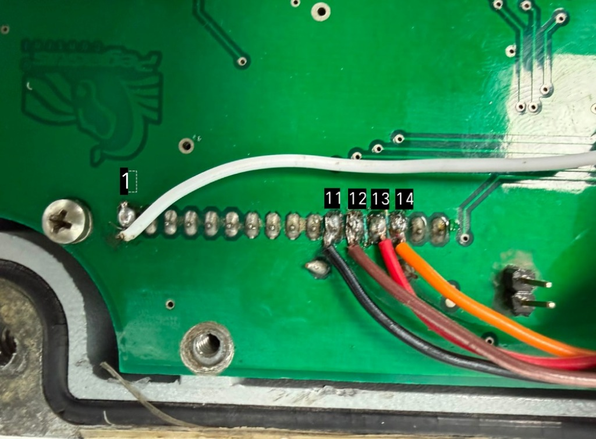

# Guía de Cableado de Hardware, Arnés e Integración SPI
## Dispensador Gasera Pegasus & Decodificador ST7565 (Orange Pi Zero 2W)

Esta guía documenta la conexión física de señales, el pinout verificado de la placa CPU Pegasus, la correspondencia exacta con el decodificador de software y las especificaciones técnicas para la fabricación de arneses y cableados en campo.

---

## 📸 1. Referencia Fotográfica de Soldadura en PCB

En la placa receptora del display de la gasera (**Pegasus 5505 Reg CPU 1v5 / Hecho en México**), las señales se toman directamente del bus del conector del display LCD ST7565:



* **Pin 1 (Extremo izquierdo):** Cable **Blanco** soldado a Pin 1 (Referencia de Tierra / GND).
* **Pines 2 al 10:** Libres / no conectados para la captura digital.
* **Pin 11:** Cable **Negro** soldado a Pin 11 (`/CS`).
* **Pin 12:** Cable **Marrón** soldado a Pin 12 (`SCLK`).
* **Pin 13:** Cable **Rojo** soldado a Pin 13 (`MOSI / SI`).
* **Pin 14:** Cable **Naranja** soldado a Pin 14 (`A0 / D/C`).

---

## ⚡ 2. Mapeo Oficial de Señales: Hardware vs. Software

> ⚠️ **Nota Histórica / Corrección respecto a Documentación Externa Previa:**
> En documentos de integración previos elaborados por terceros (como la nota técnica de Septiembre 2026), se registraron correctamente los colores de cable y los pines físicos de la placa Pegasus, pero al **no disponer del código fuente del decodificador**, los autores desconocían la función técnica de cada línea y las catalogaron genéricamente como *"Canal 0 (Señal Digital)"*, *"Canal 1"*, *"Canal 2"*, etc.
> 
> A continuación se presenta el **mapeo técnico 100% verificado y validado** directamente contra el motor decodificador en C (`st7565_trace_export.c`) y la captura de `sigrok-cli`:

| Pin PCB Pegasus | Color Cable | Conector IDC Analizador Lógico | Canal Lógico | Bit Decoder (`sample >> n`) | Señal Real ST7565 SPI | Función Técnica y Comportamiento |
| :---: | :---: | :---: | :---: | :---: | :---: | :--- |
| **Pin 1** | **Blanco** | Columna 5 - Trasera (Plano) | **GND** | N/A | **GND** | Referencia común de 0V (Tierra digital). |
| **Pin 11** | **Negro** | Columna 1 - Frontal (Muesca) | **CH1 (ch0 / D0)** | `bit 0` | **/CS (Chip Select)** | Activo en **BAJO (0)**. Habilita la recepción de bytes en el controlador ST7565. En ALTO (1), el bus queda en reposo. |
| **Pin 12** | **Marrón** | Columna 1 - Trasera (Plano) | **CH2 (ch1 / D1)** | `bit 1` | **SCLK (Serial Clock)** | Reloj síncrono serie (**~1.67 a 2.0 MHz**). El decodificador muestrea cada bit de datos en el flanco de subida (`previous_clk == 0 && clk == 1`). |
| **Pin 13** | **Rojo** | Columna 2 - Frontal (Muesca) | **CH3 (ch2 / D2)** | `bit 2` | **MOSI / SI (Serial In)** | Flujo de datos serie (Master Out -> Display In). Se desplaza con MSB primero (`byte = (byte << 1) \| bit2`). |
| **Pin 14** | **Naranja** | Columna 2 - Trasera (Plano) | **CH4 (ch3 / D3)** | `bit 3` | **A0 / D/C (Data / Command)** | Selector de modo: **0 = Comando** (Set Page `0xB0..0xB7`, Set Column, Reset, etc.); **1 = Datos** (escritura directa a la VRAM del LCD). |

---

## 📐 3. Diagrama Esquemático de Conexión

```
Placa Gasera Pegasus (5505 Reg CPU 1v5)             Analizador Lógico USB 8CH (24 MHz)
+------------------------------------+             +----------------------------------+
|                                    |             | Conector Macho 2x5 IDC (Vista)   |
|  [Pin 1]  (GND)      ------------ (Blanco) ----->| [GND]       (Pin 10 / Col 5 Trasera)
|  [Pin 11] (/CS)      ------------ (Negro) ------>| [CH1 / D0]  (Pin 1  / Col 1 Frontal) 
|  [Pin 12] (SCLK)     ------------ (Marron) ----->| [CH2 / D1]  (Pin 2  / Col 1 Trasera) 
|  [Pin 13] (MOSI/SI)  ------------ (Rojo) ------->| [CH3 / D2]  (Pin 3  / Col 2 Frontal) 
|  [Pin 14] (A0/DC)    ------------ (Naranja) ---->| [CH4 / D3]  (Pin 4  / Col 2 Trasera) 
+------------------------------------+             +----------------------------------+
                                                                   |
                                                            (Cable Mini-USB)
                                                                   v
                                                    +----------------------------------+
                                                    | HUB Sabrent USB / Ethernet       |
                                                    +----------------------------------+
                                                                   |
                                                            (Conexión Host)
                                                                   v
                                                    +----------------------------------+
                                                    | Orange Pi Zero 2W (Allwinner H618|
                                                    | Ubuntu Linux 6.1 XFCE / Python3) |
                                                    +----------------------------------+
```

---

## 🛠️ 4. Guía de Fabricación de Arneses y Cableado Industrial

Para garantizar máxima estabilidad y durabilidad en el entorno hostil de una estación de gas (donde existen motores de bombeo trifásicos, vibraciones y pulsos electromagnéticos por solenoides):

### A. Especificaciones de Materiales
1. **Conductor:** Cable multifilar flexible de cobre estañado **AWG 26** o **AWG 28**. Evitar cable sólido (unifilar), ya que las vibraciones continuas terminan quebrándolo.
2. **Conector IDC Hembra:** Conector hembra 2x5 pines con paso estándar de **2.54 mm** (0.1") con clip de alivio de tensión (*strain relief*).
3. **Malla Apantallada:** Si la tirada supera los 20 cm, utilizar cable blindado apantallado con malla de cobre trenzado conectada a la tierra metálica en un único extremo.

### B. Longitudes Recomendadas
* **Ideal:** **15 cm a 25 cm** directo entre los pines de la placa CPU Pegasus y el analizador lógico.
* **Máximo sin transceptores:** **30 cm a 40 cm**. Superar esta distancia a 2 MHz provocará redondeo de flancos en `SCLK` por la capacitancia parásita (50–100 pF/m) y lecturas corruptas de dígitos.

### C. Alivio de Tensión y Fijación Mecánica en PCB
1. **Soldadura limpia:** Soldar los cables a los orificios pasantes de los pines 1, 11, 12, 13 y 14 utilizando estaño con alma de resina y temperatura controlada (~300 °C - 330 °C).
2. **Aislamiento individual:** Cubrir cada punto soldado con tubo termorretráctil (*heat shrink*) de 1.5 mm o 2.0 mm.
3. **Fijación antivibración:** Aplicar una gota de adhesivo estructural o silicón neutro (no acético) sobre el mazo de cables a 1–2 cm de las soldaduras, anclándolo a la superficie libre de la placa para evitar que tirones accidentales arranquen las pistas de cobre.

### D. Protección Contra Ruido EMI (Técnica de Tierras Intercaladas)
Si se fabrica un arnés con cable plano (*ribbon cable*), la mejor configuración de inmunidad electromagnética consiste en intercalar líneas de tierra entre cada línea de alta frecuencia:
$$\text{GND} \;\;|\;\; \text{/CS (Pin 11)} \;\;|\;\; \text{GND} \;\;|\;\; \text{SCLK (Pin 12)} \;\;|\;\; \text{GND} \;\;|\;\; \text{MOSI (Pin 13)} \;\;|\;\; \text{GND} \;\;|\;\; \text{A0/DC (Pin 14)} \;\;|\;\; \text{GND}$$

---

## 🔍 5. Verificación de Funcionamiento tras el Cableado

Una vez instalado el arnés y conectado el analizador USB al SBC:

1. **Verificar que el analizador lógico es detectado:**
   ```bash
   sigrok-cli --driver fx2lafw --scan
   # Debe responder: fx2lafw:conn=... - Saleae Logic with 8 channels: D0 D1 D2 D3 D4 D5 D6 D7
   ```

2. **Probar captura en vivo desde terminal:**
   ```bash
   sigrok-cli --driver fx2lafw --config samplerate=4000000 --channels D0,D1,D2,D3 --continuous -O binary | ./st7565_trace_export --stream 4000000
   ```
   * Si el cableado es correcto, comenzarán a emitirse líneas `E <sample> <dc> <value> <page> <col>` al pulsar teclas o cambiar el display.
   * Si se reciben ráfagas de ceros o no hay eventos, revisar que el Pin 1 (GND / Blanco) y el Pin 11 (/CS / Negro) tengan buen contacto.
